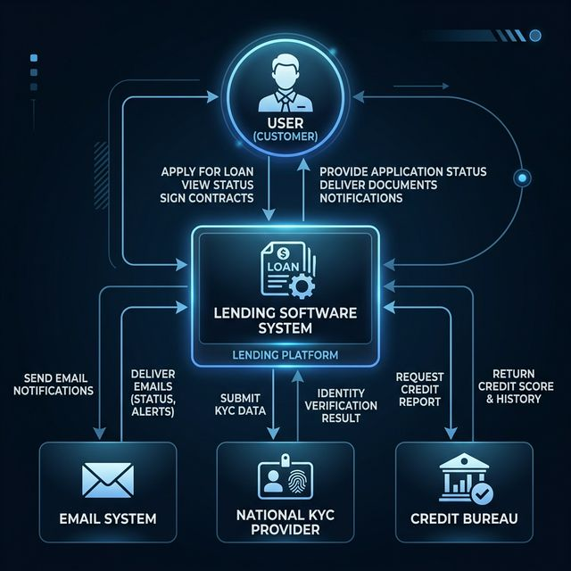
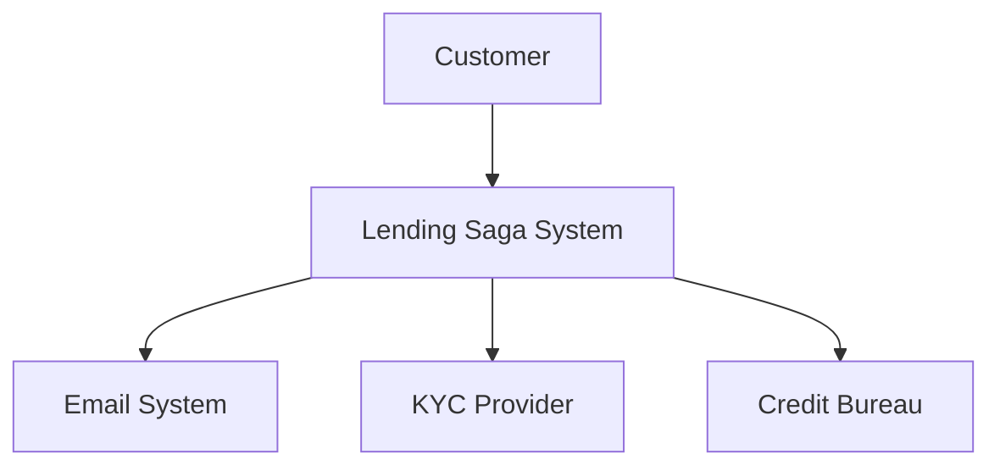

# Level 1: System Context Diagram

The System Context diagram provides a high-level view of the Lending System and its surroundings.

## Description
- **Customer**: A borrower who wants to apply for a loan.
- **Lending Saga System**: The core system.
- **Email System**: Sends notifications.
- **KYC Provider**: Identity verification.
- **Credit Bureau**: Credit history check.
