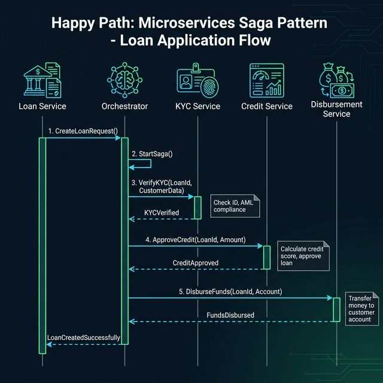
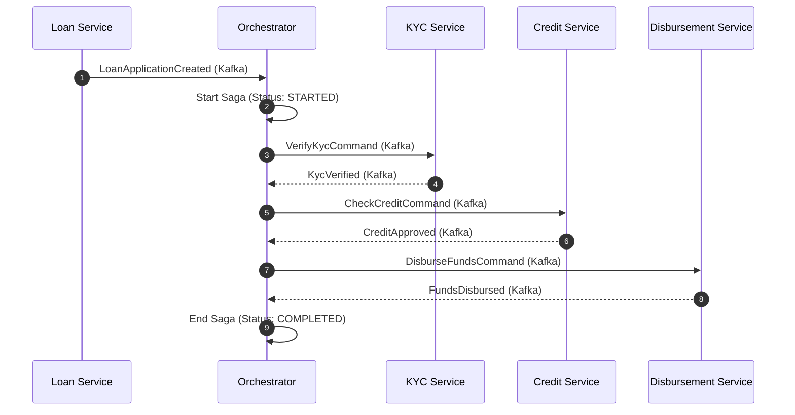
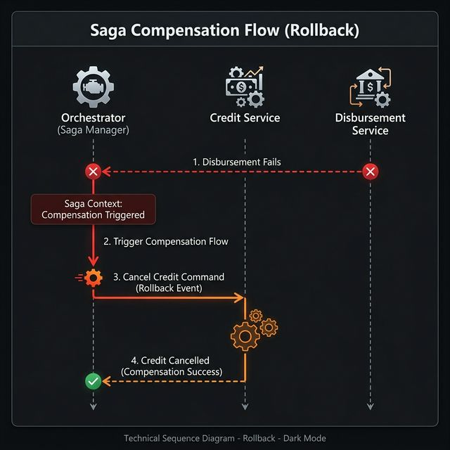
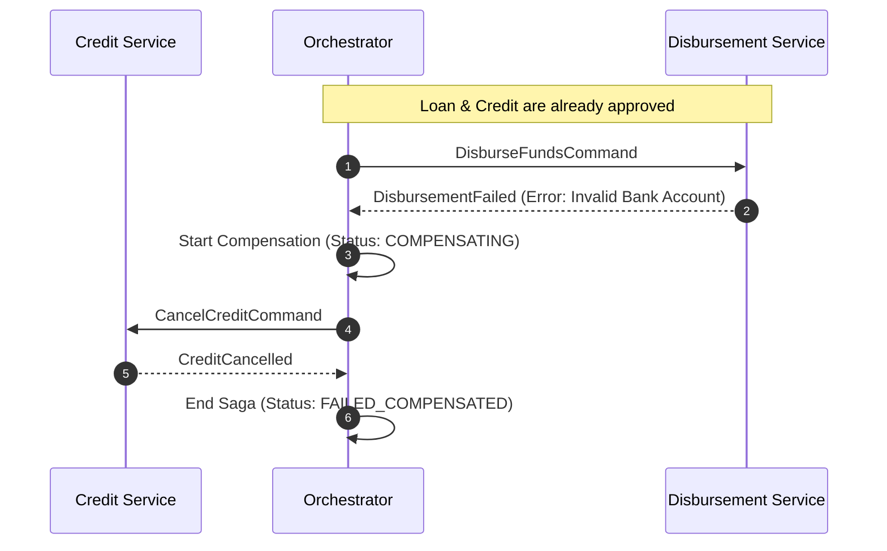

# Sequence Diagrams: Lending Saga Flows

This document describes the dynamic behavior of the system across different business scenarios.

## 1. Happy Path: Successful Loan Application
This flow represents the ideal case where all services process the requests successfully.

**Notes:**
- **Step 1**: Triggered by the REST API in Loan Service.
- **Orchestration**: The Orchestrator manages the state transition after each event.
- **Asynchronous**: All communication between services happens via Kafka.

---

## 2. Compensation Path: Disbursement Failure
This flow occurs when the final step (Disbursement) fails, requiring the system to roll back (compensate) previous successful actions (like Credit approval).

**Notes:**
- **State Guarantee**: The Orchestrator ensures that even if a failure occurs at the last step, the system eventually reaches a consistent state (Credit is cancelled).
- **Idempotency**: Credit Service must handle `CancelCreditCommand` safely even if it's already cancelled or if the original `CheckCredit` was never processed.
