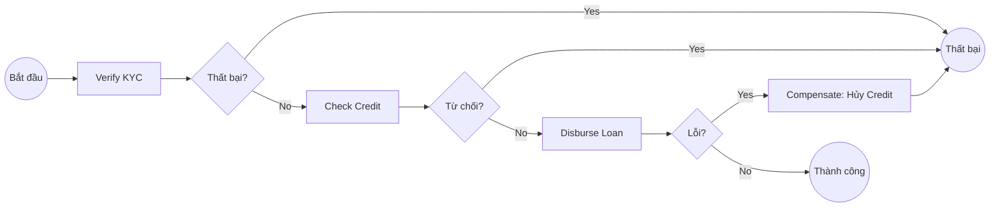

# So sánh Saga Pattern (Custom) và Camunda BPM

Tài liệu này tổng hợp các câu hỏi và giải đáp về việc áp dụng Camunda BPM vào dự án `lending-saga` thay thế cho giải pháp Custom Saga Orchestrator hiện tại.

## 1. Saga Pattern là Design Pattern hay Workflow?
*   **Saga Pattern là một Architectural Design Pattern**: Nó cung cấp giải pháp cho bài toán giao dịch phân tán (Distributed Transaction) trong Microservices mà không dùng 2PC.
*   **Workflow là quy trình nghiệp vụ**: Là chuỗi các bước (KYC -> Credit -> Disbursement).
*   **Mối liên hệ**: Ta dùng các công cụ như Camunda để thực thi (implement) Saga Pattern nhằm điều phối Workflow.

## 2. So sánh Custom Saga vs Camunda

| Đặc tính | Custom Saga (Spring State Machine) | Camunda BPM |
| :--- | :--- | :--- |
| **Định nghĩa luồng** | Java DSL code (`SagaStateMachineConfig.java`) | Sơ đồ trực quan (BPMN 2.0) |
| **Quản lý trạng thái** | Tự code bảng DB và logic lưu trữ | Engine tự quản lý toàn bộ trạng thái |
| **Xử lý Timeout** | Quét DB định kỳ (SagaTimeoutJob) | Timer Boundary Event (Tự động) |
| **Bù trừ (Compensation)** | Code logic switch-case phức tạp | Tự động gọi lệnh bù cho các task đã hoàn thành |
| **Tính trực quan** | Thấp (chỉ thấy code) | Cao (Xem trực tiếp flow trên Cockpit web) |

## 3. Mô phỏng luồng BPMN cho Lending Saga

## 4. Cơ chế giao tiếp với Microservices
Camunda đóng vai trò như một **Orchestration Service (Nhạc trưởng)** và có thể giao tiếp qua:

*   **REST API (Push)**: Gọi trực tiếp Endpoint của service khác. Phù hợp cho xử lý nhanh, đồng bộ.
*   **Kafka (Event-driven)**: Gửi lệnh qua Kafka và chờ sự kiện phản hồi. Tối ưu cho hệ thống phân tán, chịu lỗi tốt.
*   **External Worker (Pull)**: Các service chủ động lên Camunda nhặt việc. Phù hợp nhất cho khả năng mở rộng (Scalability).

## 5. Kết luận
Chuyển đổi sang Camunda giúp:
1.  **Tách rời logic điều phối** khỏi logic nghiệp vụ của Service.
2.  **Giảm thiểu Code Boilerplate** (xóa bỏ StateMachine config, Timeout job).
3.  **Quản trị vận hành tốt hơn**: Dễ dàng theo dõi, retry hoặc can thiệp vào các khoản vay bị lỗi trực tiếp từ giao diện quản trị.
