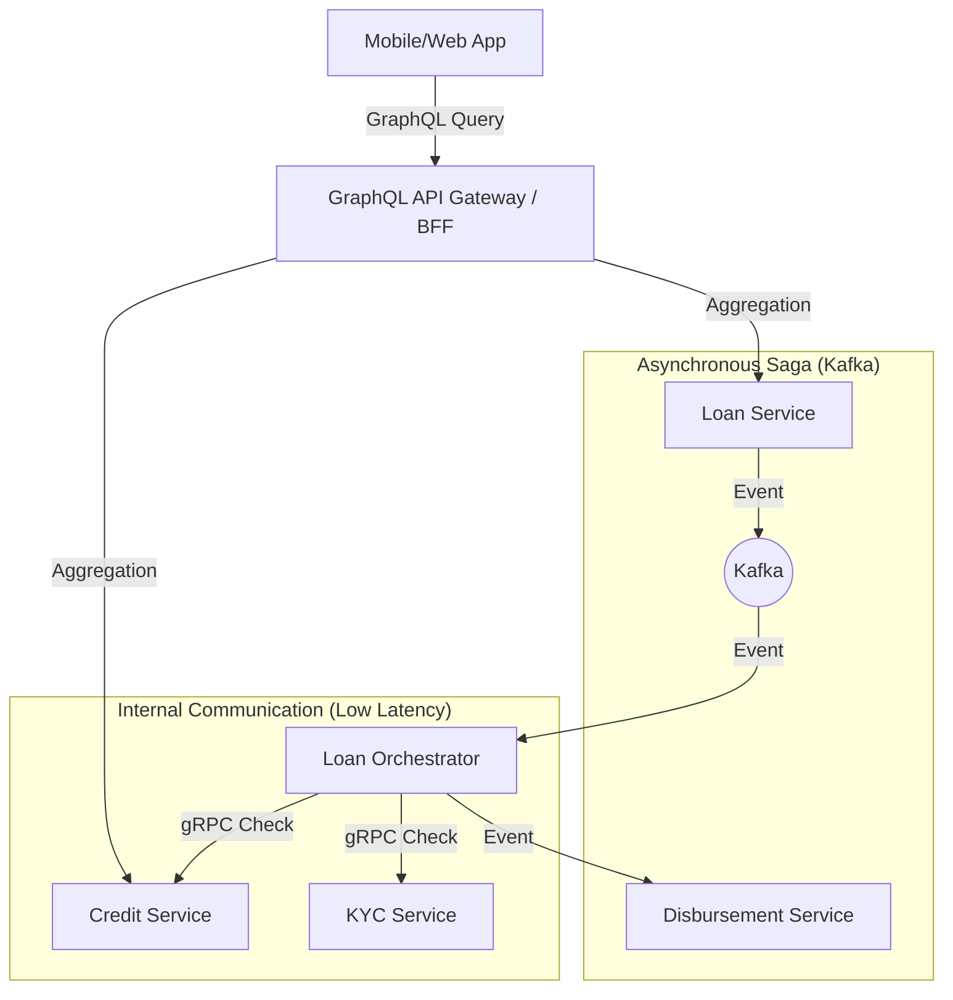

# So sánh Giao thức: GraphQL vs gRPC

Tài liệu này cung cấp cái nhìn chi tiết về hai giao thức phổ biến trong kiến trúc Microservices hiện đại: GraphQL và gRPC, đồng thời phân tích khả năng áp dụng vào dự án **Lending Saga**.

## 1. Tổng quan về GraphQL và gRPC

### GraphQL (Graph Query Language)
Được phát triển bởi Facebook, GraphQL là một ngôn ngữ truy vấn cho API và một runtime để thực hiện các truy vấn đó bằng cách sử dụng hệ thống type đã định nghĩa cho dữ liệu của bạn.

*   **Cơ chế:** Client yêu cầu chính xác những gì họ cần, và server trả về đúng như vậy.
*   **Giao thức truyền tải:** Thường chạy trên HTTP/1.1 hoặc HTTP/2 (JSON).
*   **Đặc điểm nổi bật:** Strong typing, No over-fetching/under-fetching.

### gRPC (Google Remote Procedure Call)
Được phát triển bởi Google, gRPC là một framework RPC hiện đại, hiệu năng cao, có thể chạy trong mọi môi trường.

*   **Cơ chế:** Sử dụng Protocol Buffers (protobuf) làm ngôn ngữ định nghĩa giao diện (IDL) và cơ chế đóng gói tin nhắn.
*   **Giao thức truyền tải:** Chạy trên HTTP/2 (Binary).
*   **Đặc điểm nổi bật:** Hiệu năng cực cao, hỗ trợ bidirectional streaming.

---

## 2. Bảng so sánh chi tiết

| Tiêu chí | GraphQL | gRPC |
| :--- | :--- | :--- |
| **Định dạng dữ liệu** | JSON (Văn bản) | Protocol Buffers (Binary) |
| **Mô hình** | Truy vấn dữ liệu (Client-driven) | Gọi hàm từ xa (Procedure-driven) |
| **Hiệu năng** | Trung bình (do overhead của JSON và phân giải truy vấn) | Rất cao (Binary nhỏ gọn, HTTP/2 tối ưu) |
| **Streaming** | Subscription (thường qua WebSockets) | Hỗ trợ tốt (Unidirectional, Bidirectional) |
| **Tính linh hoạt** | Rất cao (Client tự chọn field) | Thấp (Contract nghiêm ngặt) |
| **Browser Support** | Tốt (Native support qua HTTP) | Hạn chế (Cần gRPC-Web làm proxy) |
| **Caching** | Khó khăn (thường dùng POST) | Phụ thuộc vào implementation (thường k dùng cache tầng giao thức) |

---

## 3. Trade-off (Sự đánh đổi)

### GraphQL: Linh hoạt vs Phức tạp
*   **Ưu điểm:** Giảm số lượng round-trip từ Client tới Server. Chỉ lấy dữ liệu cần thiết.
*   **Nhược điểm:** Dễ gặp vấn đề N+1 query nếu không cấu hình DataLoader. Server side phức tạp hơn để xử lý việc phân giải (resolve) các truy vấn lồng nhau. Khó giới hạn độ phức tạp của truy vấn từ client (Query depth/complexity).

### gRPC: Hiệu năng vs Khả năng tiếp cận
*   **Ưu điểm:** Tốc độ serialization/deserialization cực nhanh. Payload kích thước nhỏ. Mã nguồn client/server được tạo tự động từ file `.proto` (Type safety cao giữa các service).
*   **Nhược điểm:** Con người không đọc được binary payload (khó debug trực tiếp). Cần công cụ hỗ trợ để test (như Postman mới, BloomRPC, hoặc Evans CLI).

---

## 4. Use Case

-   **GraphQL:**
    -   Backend-for-Frontend (BFF).
    -   Ứng dụng Mobile/Web cần lấy dữ liệu từ nhiều nguồn khác nhau.
    -   Hệ thống có nhiều loại client với nhu cầu dữ liệu khác nhau (Dashboard vs Mobile App).

-   **gRPC:**
    -   Giao tiếp nội bộ giữa các Microservices (Internal service-to-service).
    -   Hệ thống yêu cầu độ trễ (latency) cực thấp.
    -   Truyền tải luồng dữ liệu lớn (Real-time data streaming).
    -   Môi trường Polyglot (Service Java gọi Service Go/Python/Rust).

---

## 5. Áp dụng vào dự án Lending Saga

Trong dự án **Lending Saga**, ta đã triển khai:
1.  **gRPC** làm luồng "Pre-check" đồng bộ (KYC & Credit) để thực hiện Fast-fail.
2.  **GraphQL** làm bộ mặt tổng hợp dữ liệu (Aggregation) cho Client.

### Mô hình đề xuất

